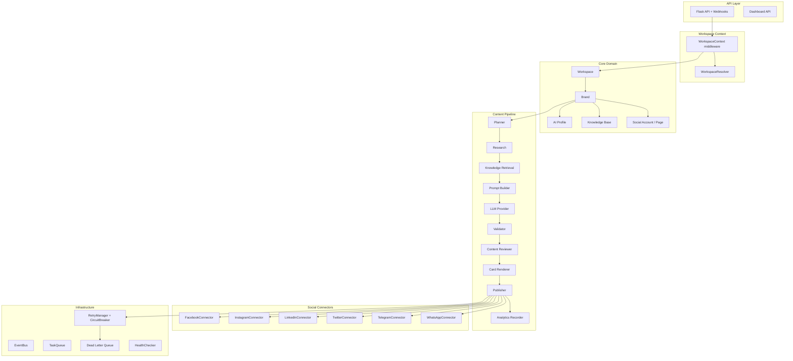

# Multi-Workspace SaaS AI Automation Platform — Implementation Plan

Transform the Kanyoza Systems Bot from a single-business Facebook bot into a production-grade, multi-workspace AI Automation SaaS. **No rewrite** — a graceful, phase-by-phase evolution that preserves every working feature.

---

## Architecture Overview



---

## Phasing Strategy

This refactor is divided into **6 phases**, each delivering a working, deployable increment. Every phase is backwards-compatible: the system remains fully operational after each phase is merged.

| Phase | Scope | Key Deliverables |
|-------|-------|------------------|
| **1** | Foundation & Models | Workspace/Brand/AIProfile/SocialAccount models, DB migrations, workspace context |
| **2** | Multi-Workspace Core | Workspace-aware services, brand-aware content engine, multi-page Facebook |
| **3** | Social Connector Interface | `SocialConnector` protocol, refactor plugins, add connector implementations |
| **4** | Content Pipeline & Knowledge Base | 10-stage pipeline, knowledge base, prompt builder, validator |
| **5** | Reliability, Analytics & Security | Circuit breaker, DLQ, health checker, analytics tracker, RBAC, audit logs |
| **6** | Card Renderer & Dashboard | Production card renderer, SVG graphics, dashboard API for all entities |

---

## Phase 1 — Foundation & Domain Models

> **Goal**: Introduce workspace, brand, AI profile, and social account domain models. Add workspace context propagation. All existing features continue to work unchanged through a "default workspace" fallback.

### Models Layer

#### [NEW] [workspace.py](file:///c:/Users/LENOVO/Downloads/AI-Automation-Platform/AI-Automation-Platform-main/models/workspace.py)
New Pydantic models:
- `Workspace` — id, name, slug, owner_email, plan (free/pro/business), settings (JSON), created_at, status
- `WorkspaceMember` — workspace_id, user_id, role (owner/admin/editor/viewer), invited_at

#### [NEW] [brand.py](file:///c:/Users/LENOVO/Downloads/AI-Automation-Platform/AI-Automation-Platform-main/models/brand.py)
- `Brand` — id, workspace_id, name, slug, logo_url, colors (JSON), tone, hashtags, language, audience_description, posting_schedule (JSON), ai_profile_id, status, created_at

#### [NEW] [ai_profile.py](file:///c:/Users/LENOVO/Downloads/AI-Automation-Platform/AI-Automation-Platform-main/models/ai_profile.py)
- `AIProfile` — id, workspace_id, name, expertise, tone, style, cta_style, emoji_level (none/low/medium/high), complexity (beginner/intermediate/advanced/expert), writing_style, prompt_template, system_prompt_override

#### [NEW] [social_account.py](file:///c:/Users/LENOVO/Downloads/AI-Automation-Platform/AI-Automation-Platform-main/models/social_account.py)
- `SocialAccount` — id, workspace_id, brand_id (nullable), platform (facebook/instagram/linkedin/twitter/telegram/whatsapp/tiktok), platform_account_id, access_token (encrypted), account_name, timezone, posting_schedule (JSON), preferred_content_types, enabled, health_status, last_health_check, created_at

---

### Core Layer

#### [NEW] [workspace_context.py](file:///c:/Users/LENOVO/Downloads/AI-Automation-Platform/AI-Automation-Platform-main/core/workspace_context.py)
Thread-local + Flask `g` context holder:
```python
class WorkspaceContext:
    workspace_id: str
    brand_id: Optional[str]
    social_account_id: Optional[str]
```
- `get_current_workspace()` → returns context from Flask `g` or thread-local
- `set_workspace_context(workspace_id, brand_id=None)` → sets context
- Flask `@before_request` middleware that reads workspace from header `X-Workspace-ID` or auth token
- **Default workspace fallback**: If no workspace header, use env-configured `DEFAULT_WORKSPACE_ID` → zero breaking changes for existing single-tenant deployment

#### [MODIFY] [multi_tenant.py](file:///c:/Users/LENOVO/Downloads/AI-Automation-Platform/AI-Automation-Platform-main/core/multi_tenant.py)
- Deprecate `Tenant` class in favour of `Workspace` model
- Add a compatibility shim: `Tenant.__init__` delegates to `Workspace`
- `MultiTenantEngine` renamed to `WorkspaceManager`, wraps the new `WorkspaceRepository`

---

### Repository Layer

#### [NEW] [workspace_repository.py](file:///c:/Users/LENOVO/Downloads/AI-Automation-Platform/AI-Automation-Platform-main/repositories/workspace_repository.py)
CRUD for `Workspace`, with Supabase backend + in-memory fallback

#### [NEW] [brand_repository.py](file:///c:/Users/LENOVO/Downloads/AI-Automation-Platform/AI-Automation-Platform-main/repositories/brand_repository.py)
CRUD for `Brand`, always scoped by workspace_id

#### [NEW] [ai_profile_repository.py](file:///c:/Users/LENOVO/Downloads/AI-Automation-Platform/AI-Automation-Platform-main/repositories/ai_profile_repository.py)
CRUD for `AIProfile`, scoped by workspace_id

#### [NEW] [social_account_repository.py](file:///c:/Users/LENOVO/Downloads/AI-Automation-Platform/AI-Automation-Platform-main/repositories/social_account_repository.py)
CRUD for `SocialAccount`, scoped by workspace_id. Encrypts `access_token` at rest using Fernet (key from `ENCRYPTION_KEY` env var or auto-generated for dev).

---

### Migrations

#### [NEW] [001_workspaces.sql](file:///c:/Users/LENOVO/Downloads/AI-Automation-Platform/AI-Automation-Platform-main/migrations/001_workspaces.sql)
Supabase-compatible SQL:
```sql
CREATE TABLE IF NOT EXISTS workspaces (...);
CREATE TABLE IF NOT EXISTS brands (...);
CREATE TABLE IF NOT EXISTS ai_profiles (...);
CREATE TABLE IF NOT EXISTS social_accounts (...);
CREATE TABLE IF NOT EXISTS workspace_members (...);
```
RLS policies for workspace isolation.

---

### Config Updates

#### [MODIFY] [settings.py](file:///c:/Users/LENOVO/Downloads/AI-Automation-Platform/AI-Automation-Platform-main/config/settings.py)
Add fields:
- `default_workspace_id: str = ""` — used when no workspace header is present
- `encryption_key: str = ""` — Fernet key for credential encryption
- Relax `REQUIRED_VARS` — `page_access_token` and `page_id` no longer required at startup (they live in `social_accounts` table instead)

#### [MODIFY] [dependency_registry.py](file:///c:/Users/LENOVO/Downloads/AI-Automation-Platform/AI-Automation-Platform-main/dependency_registry.py)
Register new repositories and `WorkspaceManager` in the container.

---

## Phase 2 — Multi-Workspace Core Services

> **Goal**: Make ContentEngine, Scheduler, Gemini service, TopicSelector, and Persona workspace/brand-aware. Each brand generates completely different content.

### Content Engine

#### [MODIFY] [content_engine.py](file:///c:/Users/LENOVO/Downloads/AI-Automation-Platform/AI-Automation-Platform-main/services/content_engine.py)
- `ContentEngine` becomes stateless — remove module-level `content_engine` singleton
- `generate_post(brand: Brand, ai_profile: AIProfile, topic: Optional[str])` accepts brand/profile context
- Topic bank moved from hardcoded dict to brand's knowledge base (with hardcoded fallback for backwards-compat)
- `CaptionBuilder.build()` uses brand's tone, hashtags, and language

#### [NEW] [prompt_builder.py](file:///c:/Users/LENOVO/Downloads/AI-Automation-Platform/AI-Automation-Platform-main/services/prompt_builder.py)
Replaces scattered prompt construction:
- `build_post_prompt(brand, ai_profile, topic, knowledge_context)` → returns complete Gemini prompt
- `build_chat_prompt(brand, ai_profile, user_profile, conversation_history)` → for Messenger
- Uses AI Profile fields: tone, expertise, emoji_level, complexity, CTA style
- Each brand generates fundamentally different prompts

### Scheduler

#### [MODIFY] [post_scheduler.py](file:///c:/Users/LENOVO/Downloads/AI-Automation-Platform/AI-Automation-Platform-main/scheduler/post_scheduler.py)
- Replace single `PostScheduler` with `BrandSchedulerManager`:
  - Loads all active brands + their posting schedules from DB
  - Creates a lightweight per-brand `BrandScheduler` (owns its own `_fired_slots`, timezone, hours, queue)
  - No shared scheduler state between brands
  - One brand failing never affects others (isolated try/except per brand tick)
- Keep the existing `PostScheduler` as the implementation for a single brand's schedule
- `BrandSchedulerManager.start()` replaces `scheduler.start()` in lifecycle

### Persona

#### [MODIFY] [persona.py](file:///c:/Users/LENOVO/Downloads/AI-Automation-Platform/AI-Automation-Platform-main/core/persona.py)
- `BotPersona` constructor accepts `AIProfile`
- `build_system_prompt()` uses `AIProfile.expertise`, `.tone`, `.writing_style` instead of hardcoded "KanyozaBot" identity
- Keep `bot_persona` singleton as the default for backwards-compatibility

### Facebook Service

#### [MODIFY] [facebook.py](file:///c:/Users/LENOVO/Downloads/AI-Automation-Platform/AI-Automation-Platform-main/services/facebook.py)
- `FacebookService.__init__` can accept `page_access_token` and `page_id` as parameters (instead of only reading from `settings`)
- Factory function: `FacebookService.for_account(social_account: SocialAccount)` → creates instance bound to that page
- Keep `facebook = FacebookService()` singleton as the default for backwards-compat

### Post Workflow

#### [MODIFY] [post_workflow.py](file:///c:/Users/LENOVO/Downloads/AI-Automation-Platform/AI-Automation-Platform-main/workflows/post_workflow.py)
- `PostPublishWorkflow.__init__` accepts `brand: Brand` and `ai_profile: AIProfile`
- `SelectTopicStep` uses brand's topic categories/knowledge base
- `GenerateContentStep` passes brand/profile to `ContentEngine`
- `PublishStep` publishes only to the brand's connected social accounts (not all plugins)

### Domain Layer

#### [MODIFY] [topic_selector.py](file:///c:/Users/LENOVO/Downloads/AI-Automation-Platform/AI-Automation-Platform-main/domain/content/topic_selector.py)
- `TopicSelector.__init__` accepts optional `brand: Brand` to load brand-specific categories
- Falls back to built-in `CATEGORIES` when brand has no custom topics
- Brand-specific topic banks loaded from brand's knowledge base entries tagged as "topics"

---

## Phase 3 — Social Connector Interface

> **Goal**: Create a unified `SocialConnector` protocol that all platforms implement. Refactor existing plugins into connectors. Future platforms only need a new connector file.

### Connector Protocol

#### [NEW] [connector.py](file:///c:/Users/LENOVO/Downloads/AI-Automation-Platform/AI-Automation-Platform-main/services/connectors/connector.py)
```python
class SocialConnector(Protocol):
    platform: str
    
    def publish(self, content: str, image_bytes: Optional[bytes] = None, **kwargs) -> ConnectorResult: ...
    def delete(self, post_id: str) -> bool: ...
    def edit(self, post_id: str, content: str) -> bool: ...
    def health(self) -> ConnectorHealth: ...
    def validate(self) -> bool: ...
    def fetch_comments(self, post_id: str, limit: int = 50) -> list[Comment]: ...
    def fetch_messages(self, limit: int = 50) -> list[Message]: ...

@dataclass
class ConnectorResult:
    ok: bool
    post_id: Optional[str]
    platform: str
    error: Optional[str]
    metadata: dict
```

#### [NEW] [facebook_connector.py](file:///c:/Users/LENOVO/Downloads/AI-Automation-Platform/AI-Automation-Platform-main/services/connectors/facebook_connector.py)
Wraps `FacebookService` behind the `SocialConnector` protocol. Accepts `SocialAccount` in constructor.

#### [NEW] [twitter_connector.py](file:///c:/Users/LENOVO/Downloads/AI-Automation-Platform/AI-Automation-Platform-main/services/connectors/twitter_connector.py)
Refactored from existing `services/twitter.py`.

#### [NEW] [linkedin_connector.py](file:///c:/Users/LENOVO/Downloads/AI-Automation-Platform/AI-Automation-Platform-main/services/connectors/linkedin_connector.py)
Refactored from existing `services/linkedIn.py`.

#### [NEW] [instagram_connector.py](file:///c:/Users/LENOVO/Downloads/AI-Automation-Platform/AI-Automation-Platform-main/services/connectors/instagram_connector.py)
New implementation using Facebook Graph API (Instagram is managed through Facebook pages).

#### [NEW] [telegram_connector.py](file:///c:/Users/LENOVO/Downloads/AI-Automation-Platform/AI-Automation-Platform-main/services/connectors/telegram_connector.py)
New connector using Telegram Bot API.

#### [NEW] [whatsapp_connector.py](file:///c:/Users/LENOVO/Downloads/AI-Automation-Platform/AI-Automation-Platform-main/services/connectors/whatsapp_connector.py)
Refactored from existing `services/whatsApp.py`.

#### [NEW] [connector_factory.py](file:///c:/Users/LENOVO/Downloads/AI-Automation-Platform/AI-Automation-Platform-main/services/connectors/connector_factory.py)
```python
def create_connector(account: SocialAccount) -> SocialConnector:
    """Factory: creates the right connector for a social account."""
```

### Plugin Bridge

#### [MODIFY] [base.py](file:///c:/Users/LENOVO/Downloads/AI-Automation-Platform/AI-Automation-Platform-main/plugins/base.py)
- `Plugin` base class gains a `connector: Optional[SocialConnector]` property
- `PluginRegistry.publish_all()` delegates to connectors
- Existing `FacebookPlugin`, `TwitterPlugin`, `LinkedInPlugin` remain but delegate to their new connectors internally (backwards-compat)

---

## Phase 4 — Content Pipeline & Knowledge Base

> **Goal**: Replace the current 4-step pipeline with a full 10-stage pipeline. Add per-brand knowledge base with lightweight semantic search.

### Content Pipeline

#### [NEW] [pipeline.py](file:///c:/Users/LENOVO/Downloads/AI-Automation-Platform/AI-Automation-Platform-main/services/pipeline/pipeline.py)
10-stage pipeline engine (reusing the existing `Workflow` base class):

```
1. PlannerStep        — selects topic, content type, and strategy for this post
2. ResearchStep       — scrapes/summarizes relevant current information (optional)
3. KnowledgeStep      — retrieves relevant brand knowledge base entries
4. PromptBuilderStep  — assembles the complete LLM prompt with brand context
5. LLMStep            — calls Gemini (or other provider) with the assembled prompt
6. ValidatorStep      — validates output structure, word count, tone compliance
7. ReviewerStep       — content quality check, brand voice consistency
8. CardRendererStep   — renders visual card (if image post)
9. PublisherStep      — publishes to all connected social accounts for this brand
10. AnalyticsStep     — records metrics, emits events
```

Each step is an independent `Step` subclass. The pipeline is a `Workflow`.

### Knowledge Base

#### [NEW] [knowledge_base.py](file:///c:/Users/LENOVO/Downloads/AI-Automation-Platform/AI-Automation-Platform-main/services/knowledge_base.py)
Per-brand knowledge store:
- `KnowledgeBase(brand_id)` 
- `.add_document(content, doc_type, metadata)` — stores text with TF-IDF vectors
- `.search(query, top_k=5)` → returns relevant document chunks
- Storage: Supabase table `knowledge_entries` (workspace_id, brand_id, content, doc_type, embedding_json, metadata)
- **Lightweight semantic search**: TF-IDF + cosine similarity using Python stdlib + `math` (no numpy required)
- **pgvector upgrade path**: When `pgvector` is available, switch to real vector embeddings from Gemini's embedding API

#### [NEW] [knowledge_repository.py](file:///c:/Users/LENOVO/Downloads/AI-Automation-Platform/AI-Automation-Platform-main/repositories/knowledge_repository.py)
CRUD + vector search for knowledge entries, scoped by brand_id.

---

## Phase 5 — Reliability, Analytics & Security

> **Goal**: Add production-grade reliability patterns, comprehensive analytics, and security layer.

### Reliability

#### [NEW] [reliability.py](file:///c:/Users/LENOVO/Downloads/AI-Automation-Platform/AI-Automation-Platform-main/core/reliability.py)
- `RetryManager` — configurable retry with exponential backoff + jitter
- `CircuitBreaker` — per-service circuit breaker (closed/open/half-open states, failure threshold, reset timeout)
- `HealthChecker` — periodic health probes for all registered services
- `DeadLetterQueue` — local file-based DLQ for failed publish jobs (JSON file, replay capability)
- `GracefulFallback` — decorator that catches exceptions and returns a fallback value

#### [MODIFY] [retry.py](file:///c:/Users/LENOVO/Downloads/AI-Automation-Platform/AI-Automation-Platform-main/utils/retry.py)
Enhance `smart_retry` to integrate with `CircuitBreaker` — skip retries when circuit is open.

### Analytics

#### [NEW] [analytics_engine.py](file:///c:/Users/LENOVO/Downloads/AI-Automation-Platform/AI-Automation-Platform-main/analytics/analytics_engine.py)
Per-workspace/brand analytics:
- Posts published (by brand, platform, time)
- Engagement metrics (likes, comments, shares — fetched from connectors)
- AI latency (generation time, render time)
- Publish success/failure rates
- API usage and token consumption
- Cost estimation (tokens × price per token)
- Brand growth tracking
- Top performing topics
- Best publishing hours analysis

All stored in Supabase `analytics_events` table, scoped by workspace_id + brand_id.

#### [MODIFY] [tracker.py](file:///c:/Users/LENOVO/Downloads/AI-Automation-Platform/AI-Automation-Platform-main/analytics/tracker.py)
Enhance to accept workspace_id and brand_id in all tracking calls.

### Security

#### [NEW] [auth.py](file:///c:/Users/LENOVO/Downloads/AI-Automation-Platform/AI-Automation-Platform-main/core/auth.py)
- `WorkspaceIsolation` middleware — ensures every DB query is scoped to the current workspace
- `RBACGuard` — role-based permission checks (owner > admin > editor > viewer)
- `AuditLogger` — logs all mutating actions to `audit_log` table

#### [NEW] [api_tokens.py](file:///c:/Users/LENOVO/Downloads/AI-Automation-Platform/AI-Automation-Platform-main/core/api_tokens.py)
- Per-workspace API token management
- Token generation, rotation, revocation
- Stored in Supabase with hashed values

#### [MODIFY] [api_auth.py](file:///c:/Users/LENOVO/Downloads/AI-Automation-Platform/AI-Automation-Platform-main/core/api_auth.py)
Extend to support workspace-scoped API tokens in addition to the existing `MASTER_API_TOKEN`.

#### [NEW] [credential_vault.py](file:///c:/Users/LENOVO/Downloads/AI-Automation-Platform/AI-Automation-Platform-main/core/credential_vault.py)
- Encrypts all social account tokens at rest using Fernet symmetric encryption
- Key rotation support
- Falls back to env var storage for single-tenant mode

---

## Phase 6 — Card Renderer & Dashboard API

> **Goal**: Enhance the card renderer to production quality. Expand the dashboard API to manage all new entities.

### Card Renderer Enhancements

#### [MODIFY] [card_renderer.py](file:///c:/Users/LENOVO/Downloads/AI-Automation-Platform/AI-Automation-Platform-main/services/card_renderer.py)
- Brand-aware rendering: uses brand's colors, logo, fonts
- New card types: Timeline, Code Snippet, Architecture Diagram, Performance Chart, Flowchart, Database Diagram
- Automatic font scaling + overflow detection (enhance existing `typography.py`)
- Dark mode and light mode theme support
- Brand logo watermark

#### [NEW] Card Templates
New Jinja2 templates in `templates/cards/`:
- `timeline.html`
- `code_snippet.html`
- `architecture.html`
- `performance_chart.html`
- `flowchart.html`
- `database_diagram.html`

### Dashboard API

#### [MODIFY] [v1.py](file:///c:/Users/LENOVO/Downloads/AI-Automation-Platform/AI-Automation-Platform-main/api/v1.py)
Add REST endpoints:

```
# Workspaces
POST   /api/v1/workspaces
GET    /api/v1/workspaces
GET    /api/v1/workspaces/:id
PUT    /api/v1/workspaces/:id
DELETE /api/v1/workspaces/:id

# Brands
POST   /api/v1/workspaces/:id/brands
GET    /api/v1/workspaces/:id/brands
GET    /api/v1/brands/:id
PUT    /api/v1/brands/:id
DELETE /api/v1/brands/:id

# AI Profiles
POST   /api/v1/workspaces/:id/ai-profiles
GET    /api/v1/workspaces/:id/ai-profiles
PUT    /api/v1/ai-profiles/:id
DELETE /api/v1/ai-profiles/:id

# Social Accounts
POST   /api/v1/workspaces/:id/social-accounts
GET    /api/v1/workspaces/:id/social-accounts
PUT    /api/v1/social-accounts/:id
DELETE /api/v1/social-accounts/:id
POST   /api/v1/social-accounts/:id/health-check

# Knowledge Base
POST   /api/v1/brands/:id/knowledge
GET    /api/v1/brands/:id/knowledge
DELETE /api/v1/knowledge/:id
POST   /api/v1/brands/:id/knowledge/search

# Analytics
GET    /api/v1/workspaces/:id/analytics
GET    /api/v1/brands/:id/analytics

# System Health
GET    /api/v1/system/health
GET    /api/v1/system/connectors
```

---

## Preserved Existing Features

Every existing feature is **preserved and refactored** into the new architecture:

| Existing Feature | Where It Goes |
|---|---|
| Messenger AI | Becomes workspace-aware, uses brand's AI Profile |
| Code Guardian | Remains as a workspace-level service |
| Auto Fix | Stays in `guardian/auto_fix.py`, unchanged |
| Prometheus `/metrics` | Enhanced with workspace/brand labels |
| Card Renderer | Enhanced with brand themes, new card types |
| Scheduler | Wrapped by `BrandSchedulerManager` |
| Supabase integration | All repos get workspace_id column |
| Gemini integration | Wrapped by `PromptBuilder` for brand context |
| Memory | Scoped by workspace_id + user_id |
| Webhook system | Routes by page_id → workspace → brand |
| EventBus | Events gain `workspace_id` and `brand_id` fields |

---

## Free-Tier Compatibility

| Requirement | Solution |
|---|---|
| No Redis | In-memory `TaskQueue` + `threading` (already exists) |
| No Celery | `BrandSchedulerManager` with `threading.Thread` per-brand |
| No Docker/K8s | Single `gunicorn` process on Render free tier |
| No paid queues | Local `queue.Queue` (already exists) + file-based DLQ |
| No paid cloud | Supabase free + Render free + Gemini free tier |
| No numpy | TF-IDF semantic search using pure Python `math` + `collections.Counter` |
| pgvector optional | Falls back to local TF-IDF when pgvector unavailable |

---

## Performance Optimizations

1. **Prompt caching** — `PromptBuilder` caches assembled system prompts per AI Profile (LRU cache, 5-min TTL)
2. **Render asset reuse** — `RenderCache` keyed by content hash (already exists, enhanced with brand key)
3. **Duplicate Gemini call elimination** — Pipeline ensures exactly ONE LLM call per post (already enforced, now documented as contract)
4. **Connection pooling** — `HttpClient` per-service with `requests.Session` (already exists)
5. **DB query optimization** — Batch loads for brand schedules, index on `workspace_id` + `brand_id`
6. **Lazy service resolution** — Container resolves services on first use (already exists)

---

## Execution Order

> [!IMPORTANT]
> **I recommend starting with Phase 1** since it establishes the foundation all other phases depend on. Each phase is designed to be independently deployable.

| Order | Phase | Est. Files Changed/Created | Dependency |
|-------|-------|---------------------------|------------|
| 1st | Phase 1: Foundation & Models | ~15 new, ~3 modified | None |
| 2nd | Phase 2: Multi-Workspace Services | ~3 new, ~8 modified | Phase 1 |
| 3rd | Phase 3: Social Connectors | ~10 new, ~2 modified | Phase 1 |
| 4th | Phase 4: Content Pipeline & KB | ~5 new, ~2 modified | Phase 2 + 3 |
| 5th | Phase 5: Reliability & Security | ~5 new, ~3 modified | Phase 1 |
| 6th | Phase 6: Card Renderer & Dashboard | ~8 new, ~2 modified | Phase 2 + 3 |

---

## Open Questions

> [!IMPORTANT]
> **1. Database approach**: The existing code uses Supabase (PostgreSQL) with an in-memory fallback. Should I:
> - **(a)** Continue with the current pattern (Supabase when available, in-memory dict fallback)?
> - **(b)** Add SQLite as a local persistence fallback instead of in-memory dicts?

> [!IMPORTANT]
> **2. Default workspace seeding**: When the system starts for the first time with no workspaces in the DB, should I:
> - **(a)** Auto-create a "Default" workspace from existing env vars (`PAGE_ACCESS_TOKEN`, `PAGE_ID`, etc.) so the system boots identically to today?
> - **(b)** Require manual workspace creation via the API before anything works?

> [!IMPORTANT]
> **3. Phase execution**: Would you like me to:
> - **(a)** Implement all 6 phases in sequence in this conversation?
> - **(b)** Start with Phase 1 only, validate it works, then proceed phase by phase?
> - **(c)** Implement a subset of phases? If so, which ones?

> [!NOTE]
> **4. Existing tests**: The `tests/` directory exists. Should I write tests for each phase, or focus on implementation first and add tests later?

---

## Verification Plan

### Automated Tests
```bash
pytest tests/ -v                    # Existing tests still pass
pytest tests/test_workspace.py -v   # New workspace model tests
pytest tests/test_brand.py -v       # New brand model tests
pytest tests/test_connectors.py -v  # Connector interface tests
pytest tests/test_pipeline.py -v    # Pipeline stage tests
```

### Manual Verification
- System boots with no workspace configured → auto-creates default workspace
- Existing Facebook posting flow works identically
- Create a second workspace via API → verify isolation
- Create a brand with AI Profile → generate a post → verify it uses the brand's tone
- Add a second Facebook page → verify independent scheduling
- Trigger a page failure → verify other pages unaffected
- Dashboard API returns all new entities
